  

    

  
  
  

## 🧭 Sobre mim

- 🖥️ **8 anos em suporte e infraestrutura**: Microsoft Intune, Entra ID, Active Directory e licenciamento Microsoft 365
- 🤖 **Em transição para IA aplicada**: agentes, integrações (MCP / APIs) e automação de processos de TI
- 🎓 Formado em **Análise e Desenvolvimento de Sistemas** (FAM, 2026)
- 🎯 Meu foco: tirar trabalho repetitivo das equipes de TI sem tirar o controle das mãos das pessoas

## 🚀 Projetos em destaque

<table>
  <tr>
    <td width="50%" valign="top">
      <h3>🏢 <a href="https://github.com/arturssans/escritorio-npcs">Escritório de NPCs</a></h3>
      
Jogo local em pixel art: cada projeto do Claude Code vira um NPC num escritório. Você pede uma tarefa, acompanha o progresso ao vivo e aprova (ou nega) as ações do agente.

      
      
      
      
    </td>
    <td width="50%" valign="top">
      <h3>🎫 Agente de Service Desk <i>privado</i></h3>
      
Monitora a fila do GLPI, classifica chamados (ITIL) com IA, distribui por rodízio no Microsoft Teams e consulta chamados resolvidos com RAG.

      
      
      
      
    </td>
  </tr>
  <tr>
    <td width="50%" valign="top">
      <h3>🧩 Analista GLPI <i>privado</i></h3>
      
Extensão Chrome + servidor local que sugere respostas, categorias e soluções para os chamados. Nada é gravado sem aprovação humana.

      
      
      
    </td>
    <td width="50%" valign="top">
      <h3>🔔 Monitor de vouchers Microsoft</h3>
      
Varre páginas públicas da Microsoft e avisa no Telegram quando aparece desconto ou voucher de certificação.

      
      
      
    </td>
  </tr>
  <tr>
    <td colspan="2" valign="top">
      <h3>🩺 <a href="https://github.com/arturssans/laudo-diagnostico">Laudo de Diagnóstico</a></h3>
      
Roda direto do pendrive, sem instalar nada, e gera um laudo técnico do computador Windows: discos, bateria, memória, drivers, rede, eventos de erro e softwares. Sai em PDF para anexar ao chamado e em HTML com gráficos interativos, com achados e sugestões de solução por tópico.

      
      
      
      
      
    </td>
  </tr>
</table>

## 🛠️ Tecnologias

  

  
  
  
  
  
  
  

## 📚 Estudando agora

- **Microsoft AI-103**: prova prevista para dezembro de 2026

  Infra que entende de IA e IA que respeita a infra.

